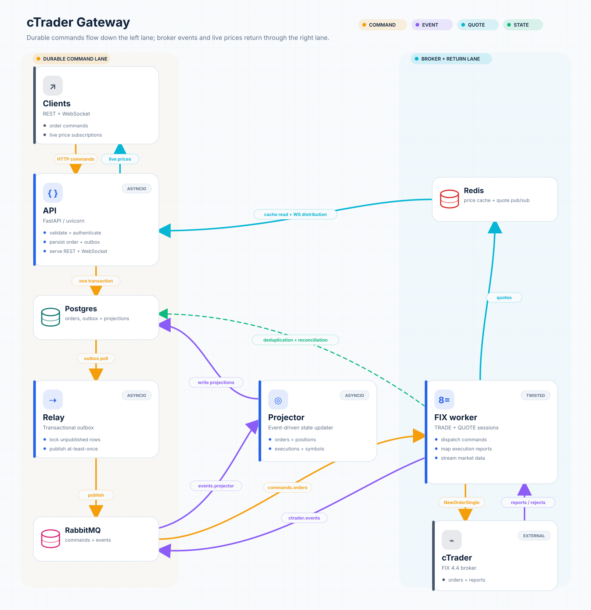

# cTrader FIX Middleware Gateway

[](https://github.com/eugene-author/ctrader-fix-gateway/actions/workflows/ci.yml)
[](https://www.python.org/)
[](https://help.ctrader.com/fix/)
[](https://docs.astral.sh/uv/)
[](https://github.com/eugene-author/ctrader-fix-gateway/releases)
[](LICENSE)

## 1. Overview

An asynchronous middleware gateway that exposes trading and live prices of the [cTrader Spotware](https://ct.spotware.com/) (used by 300+ brokers) through a clean REST and WebSocket API while communicating with the broker over FIX 4.4.

FastAPI accepts client requests, PostgreSQL stores durable state, RabbitMQ transports commands and events, Redis serves real-time prices and an isolated FIX worker owns the cTrader TRADE and QUOTE sessions.



## 2. Features

- REST API for placing, listing, inspecting, and cancelling orders.
- Position queries and asynchronous position closing.
- Real-time bid/ask prices through REST and WebSocket subscriptions.
- Separate cTrader FIX 4.4 TRADE and QUOTE sessions with reconnect handling.
- Transactional outbox for durable API-to-worker command delivery.
- Inbox deduplication and idempotent command processing.
- RabbitMQ topic exchanges, quorum queues, retries, and dead-letter routing.
- PostgreSQL persistence with SQLAlchemy 2.0 and Alembic migrations.
- Redis price cache, quote pub/sub, and per-client order rate limiting.
- HMAC-protected API keys with account isolation.
- Structured logging, Prometheus metrics, OpenTelemetry tracing, and optional Sentry reporting.
- Docker Compose environment and automated unit, contract, integration, and end-to-end tests.
- Extensible adapter architecture for integrating additional brokers and trading protocols.

## 3. Prerequisites

For the Docker workflow:

- Docker Engine with Docker Compose v2.
- A cTrader demo or live trading account only when connecting the FIX worker to a real broker.
- cTrader FIX credentials for both the **Trade** and **Price** connections.

For local development:

- Python 3.14 or newer.
- [uv](https://docs.astral.sh/uv/) for dependency and virtual-environment management.
- Docker for integration tests backed by Testcontainers.

> [!IMPORTANT]
> Begin with a cTrader **demo account**. This project can submit real orders when configured with live credentials.


## 4. Project layout

```text
.
├── app/
│   ├── adapters/brokers/ctrader/  # cTrader FIX 4.4 adapter
│   ├── api/                       # REST/WS routes, authentication, and rate limits
│   ├── cache/                     # Redis price cache and quote pub/sub
│   └── core/                      # Configuration, logging, metrics, security, and tracing
│   ├── db/                        # SQLAlchemy models, repositories, and unit of work
│   ├── domain/                    # Domain models, events, validation, and state machine
│   ├── migrations/                # Alembic database migrations
│   ├── ports/                     # Infrastructure-independent protocols
│   ├── queue/                     # RabbitMQ topology, publisher, and consumer
│   ├── schemas/                   # Pydantic request and response contracts
│   ├── services/                  # Application commands and queries
│   ├── workers/                   # Relay, FIX worker, projector, and reconciliation
│   ├── main.py                    # FastAPI application factory and entry point
├── tests/
│   ├── contract/                  # Broker-port contract tests
│   ├── integration/               # Real infrastructure through Testcontainers
│   ├── mocks/                     # Narrow FIX 4.4 test server
│   └── unit/                      # Fast isolated tests
├── deploy/
│   ├── docker/                    # Multi-stage application image
│   └── observability/             # Prometheus, alerts, and Grafana provisioning
├── docs/                          # Documentation notes and assets
├── docker-compose.yml             # Local platform and production-like services
├── pyproject.toml                 # Package metadata, dependencies, and tool configuration
└── Makefile                       # Common development commands
```

## 5. Installation and configuration

### 5.1. Clone and install

```bash
git clone https://github.com/eugene-author/ctrader-fix-gateway.git
cd ctrader-fix-gateway
uv sync --frozen
```

### 5.2. Create the environment file

```bash
cp .env.example .env
```

Generate a private API-key pepper and place the result in `API_KEY_PEPPER`:

```bash
python3 -c "import secrets; print(secrets.token_urlsafe(32))"
```

The main configuration groups are:

| Variables | Purpose |
|---|---|
| `DATABASE_URL` | PostgreSQL connection used by the API and stateful workers. |
| `REDIS_URL` | Price cache, quote pub/sub, and API rate-limiting store. |
| `RABBITMQ_URL` | Command and event transport. |
| `API_KEY_PEPPER` | Secret used to HMAC API keys before lookup. |
| `ACCOUNT_ID` | UUID from this project's `accounts` table; it is not the cTrader account number. |
| `FIX_TRADE_*` | Host, port, username, password, and sender ID for the Trade connection. |
| `FIX_QUOTE_*` | Host, port, username, password, and sender ID for the Price connection. |
| `SENTRY_DSN` | Optional Sentry reporting; disabled when empty. |
| `OTEL_EXPORTER_OTLP_ENDPOINT` | Optional OpenTelemetry collector endpoint. |
| `SYMBOLS_OVERLAY_PATH` | Trading limits for each symbol (lot size, quantity range, price step). |


### 5.3. Accessing the cTrader FIX API

cTrader supplies separate credentials for market prices and trading operations. They are not interchangeable, and this gateway opens one session for each connection.

1. Open cTrader Desktop or Web and sign in to the trading account.
2. Open **Settings** using the cog icon.
3. Select **FIX API**.
4. Set or change the FIX password if required.
5. Copy the **Trade connection** credentials into the `FIX_TRADE_*` variables.
6. Copy the **Price connection** credentials into the `FIX_QUOTE_*` variables.
7. Use the host names and ports shown by cTrader. Do not copy example broker hosts from another account.

Example mapping:

```dotenv
FIX_TRADE_HOST=<TRADE_HOST>
FIX_TRADE_PORT=5212
FIX_TRADE_SSL=true
FIX_TRADE_USERNAME=<ACCOUNT_NUMBER>
FIX_TRADE_PASSWORD=<FIX_PASSWORD>
FIX_TRADE_SENDER_COMP_ID=<TRADE_SENDER_COMP_ID>

FIX_QUOTE_HOST=<QUOTE_HOST>
FIX_QUOTE_PORT=5211
FIX_QUOTE_SSL=true
FIX_QUOTE_USERNAME=<ACCOUNT_NUMBER>
FIX_QUOTE_PASSWORD=<FIX_PASSWORD>
FIX_QUOTE_SENDER_COMP_ID=<QUOTE_SENDER_COMP_ID>
```

The project defaults `TargetCompID` to `cServer`, uses `TRADE` and `QUOTE` as the session qualifiers, and sends FIX 4.4 messages. If your cTrader credential screen provides different values, prefer the values supplied for your account.

Useful official references:

- [Get cTrader FIX credentials](https://help.ctrader.com/fix/getting-credentials/)
- [cTrader FIX API documentation](https://help.ctrader.com/fix/)
- [cTrader FIX 4.4 specification](https://help.ctrader.com/fix/specification/)

> [!NOTE]
> cTrader FIX is intended for live prices and trading operations. It does not provide account balance, margin, leverage, or historical market data; those require another cTrader API.

### 5.4. Start the infrastructure

Start PostgreSQL, Redis, RabbitMQ, and apply the database migrations:

```bash
docker compose up -d postgres redis rabbitmq migrate
docker compose wait migrate
```

### 5.5. Create an account record

Create the local account used to associate API clients, orders, and broker activity:

```bash
docker compose exec postgres psql -U gateway -d gateway -c "
INSERT INTO accounts (id, broker, external_account_id, mode, currency, enabled)
VALUES (gen_random_uuid(), 'ctrader', '<CTRADER_ACCOUNT_NUMBER>', 'hedging', 'USD', true)
RETURNING id;
"
```

Copy the returned UUID into `ACCOUNT_ID` in `.env`.

### 5.6. Start the API and application workers

```bash
docker compose up -d api relay projector
```

OpenAPI documentation is then available at:

- Swagger UI: <http://localhost:8000/docs>
- ReDoc: <http://localhost:8000/redoc>
- Metrics: <http://localhost:8000/metrics>

### 5.7. Create an API key

Replace `<ACCOUNT_ID>` and execute below. 

```bash
docker compose exec api python -c "
import asyncio
from app.core.api_keys import generate_api_key, hash_api_key, key_prefix
from app.core.config import Settings
from app.db.models import ApiClientRow
from app.db.session import create_engine, create_session_factory

async def main():
    settings = Settings()
    factory = create_session_factory(create_engine(settings.database_url))
    raw_key = generate_api_key()
    async with factory() as session:
        session.add(ApiClientRow(
            account_id='<ACCOUNT_ID>',
            name='local-operator',
            key_prefix=key_prefix(raw_key),
            api_key_hmac=hash_api_key(raw_key, pepper=settings.api_key_pepper),
            scopes=['orders:write'],
        ))
        await session.commit()
    print(f'API_KEY={raw_key}')

asyncio.run(main())
"
```
Alternatively run [`scripts/create_api_key.sh`](scripts/create_api_key.sh):
```bash
./scripts/create_api_key.sh
```


The raw API key is shown once. Send it with protected requests:

```bash
curl http://localhost:8000/api/v1/orders \
  -H "X-API-Key: <API_KEY>"
```

### 5.8. Start the FIX worker
After configuring `ACCOUNT_ID`, `FIX_TRADE_*`, and `FIX_QUOTE_*`, start the broker worker:
```bash
docker compose up -d fix-worker
```

### 5.9. Enable the monitoring stack

To enable the optional monitoring stack:

```bash
docker compose --profile monitoring up -d prometheus grafana
```

Prometheus is exposed on <http://localhost:9090> and Grafana on <http://localhost:3000>.


## 6. API reference

Health and metrics endpoints are public. Every `/api/v1/*` REST endpoint requires the API key in the `X-API-Key` header. The WebSocket endpoint accepts the key through either the `api_key` query parameter or the `X-API-Key` header.

| Method | Path | Purpose |
|---|---|---|
| GET | `/health/live` | Liveness check without dependency probes. |
| GET | `/health/ready` | Check PostgreSQL, Redis, and RabbitMQ reachability; returns `503` when unavailable. |
| GET | `/metrics` | Prometheus metrics in text exposition format. |
| POST | `/api/v1/orders` | Place an order; returns `202 Accepted`, or `200 OK` for an idempotent replay. |
| GET | `/api/v1/orders` | List orders newest first using keyset pagination and optional filters. |
| GET | `/api/v1/orders/{order_id}` | Fetch one complete order resource. |
| GET | `/api/v1/orders/{order_id}/status` | Poll the current order status projection. |
| POST | `/api/v1/orders/{order_id}/cancel` | Cancel a still-working order. |
| GET | `/api/v1/positions` | List open positions for the authenticated account. |
| GET | `/api/v1/positions/{position_id}` | Fetch one position using the broker position ID. |
| POST | `/api/v1/positions/{position_id}/close` | Submit the opposite market order that closes a position. |
| GET | `/api/v1/prices/{symbol}` | Return the latest cached quote, or `503` when unavailable. |
| GET | `/api/v1/prices?symbols=EURUSD,GBPUSD` | Return cached quotes for several comma-separated symbols; unavailable symbols are omitted. |
| GET | `/api/v1/symbols` | List all known symbols for the account, including discovery and review state. |
| WS | `/api/v1/ws/prices` | Subscribe to streaming quotes over WebSocket. |

FastAPI also exposes interactive API documentation at `/docs`, ReDoc at `/redoc`, and the OpenAPI schema at <http://localhost:8000/openapi.json>.

See the [system flow diagrams](docs/diagrams/) for a visual overview of command processing, broker execution, event projection, and real-time price delivery.

## 7. Example API requests

See [`scripts/order_commands.sh`](scripts/order_commands.sh) for a complete example.
Run it with:

```bash
./scripts/order_commands.sh
```


### 7.1. Get the latest price 

```bash
curl -sS "http://localhost:8000/api/v1/prices/EURUSD" \
  -H "X-API-Key: your-api-key"
```

For several symbols, use the batch endpoint:
```bash
curl -sS "http://localhost:8000/api/v1/prices?symbols=EURUSD,GBPUSD" \
  -H "X-API-Key: your-api-key"
```

### 7.2. Place a market order

```bash
curl -i -X POST "http://localhost:8000/api/v1/orders" \
  -H "Content-Type: application/json" \
  -H "X-API-Key: your-api-key" \
  -d '{
    "client_order_id": "demo-order-001",
    "symbol": "EURUSD",
    "side": "SELL",
    "order_type": "MARKET",
    "quantity": 1000,
    "time_in_force": "IOC"
  }'
```

`POST /orders` confirms durable acceptance, not an immediate broker fill. Poll the status URL until the order reaches a terminal state (`FILLED, REJECTED, CANCELLED, EXPIRED, or FAILED`) with returned `order_id`:

```bash
curl -sS \
  "http://localhost:8000/api/v1/orders/replace-with-order-id/status" \
  -H "X-API-Key: your-api-key" \
  | python3 -m json.tool
```
Example order:


Orders are accepted only for symbols with trading limits in `app/config/symbols.yaml`. To trade another symbol, add an entry with all six fields, then rebuild and restart so the projector reloads the file and the FIX worker sends an updated symbol list:
```bash
docker compose up -d --build projector fix-worker
```

### 7.3. Close the resulting position

The order must be `FILLED` and contain a `position_id` before it can be closed:

```bash
curl -sS -X POST \
  "http://localhost:8000/api/v1/positions/replace-with-position-id/close" \
  -H "Content-Type: application/json" \
  -H "X-API-Key: your-api-key" \
  -d '{}' \
  | python3 -m json.tool
```

Closing a position creates another asynchronous order. Copy the returned order_id and check its status:
```bash
curl -sS \
  "http://localhost:8000/api/v1/orders/replace-with-close-order-id/status" \
  -H "X-API-Key: your-api-key" \
  | python3 -m json.tool
```

## 8. WebSocket prices

See [`scripts/get_ws_prices.sh`](scripts/get_ws_prices.sh) for an example.
Run it with:
```bash
./scripts/get_ws_prices.sh
```


The WebSocket endpoint authenticates before accepting the connection. The simplest client URL passes the API key as a query parameter and subscribe to one or more symbols:

```python
import asyncio
import json

import websockets


async def main() -> None:
    url = "ws://localhost:8000/api/v1/ws/prices?api_key=your-api-key"

    async with websockets.connect(url) as websocket:
        await websocket.send(
            json.dumps({
                "action": "subscribe",
                "symbols": ["EURUSD", "GBPUSD"],
            })
        )

        async for message in websocket:
            print(json.loads(message))


asyncio.run(main())
```

Live quote frames have `type: "quote"`. When no quote arrives during `WS_HEARTBEAT_SECONDS`, the server sends `{"type": "heartbeat"}`. To stop a subscription without closing the socket, send:

```json
{"action": "unsubscribe", "symbols": ["EURUSD"]}
```

The connection is limited to `WS_MAX_SYMBOLS` active symbols. Invalid frames or an exceeded subscription limit return a frame with `type: "error"`.


## 9. Tests

Run the complete suite:

```bash
make test
```

Run individual test layers:

```bash
make test-unit
uv run pytest tests/contract -v
uv run pytest tests/integration -v
```

The integration suite uses Testcontainers to start disposable PostgreSQL, Redis, and RabbitMQ instances. Docker must be running. A small mock FIX 4.4 server exercises the broker path without requiring a real cTrader account.


To execute the end-to-end gateway flow against the mock FIX server:

```bash
uv run pytest tests/integration/workers/test_end_to_end.py -v
```

## 10. License

Released under the [MIT License](LICENSE).

## 11. Disclaimer

This project is provided for demonstration and educational purposes. Trading involves financial risk. Validate the system with a demo account before considering any live connection.
