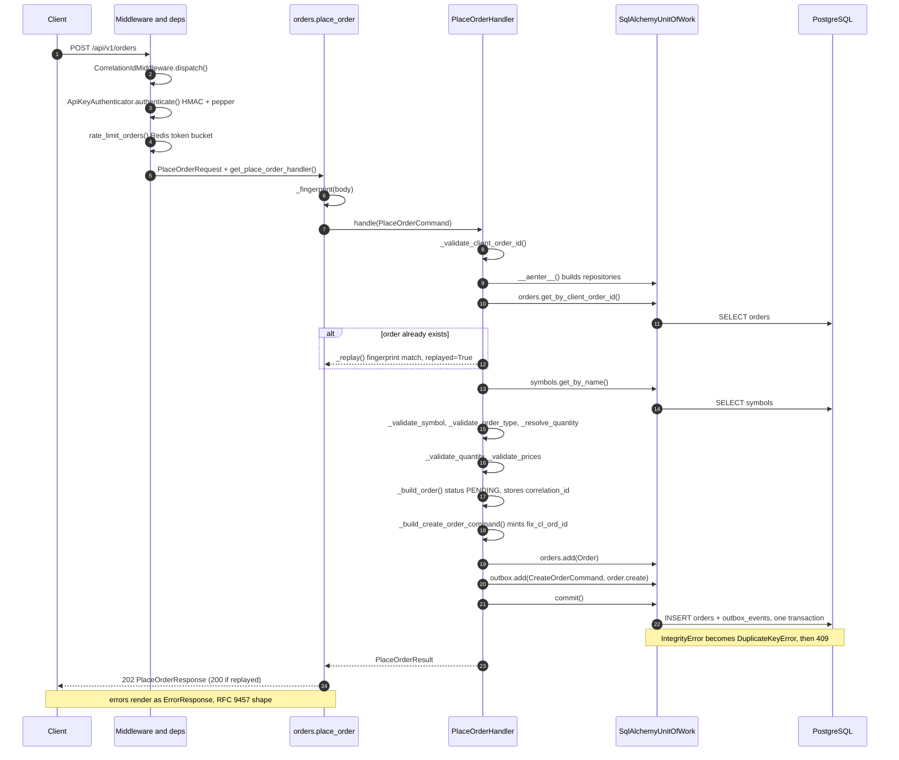
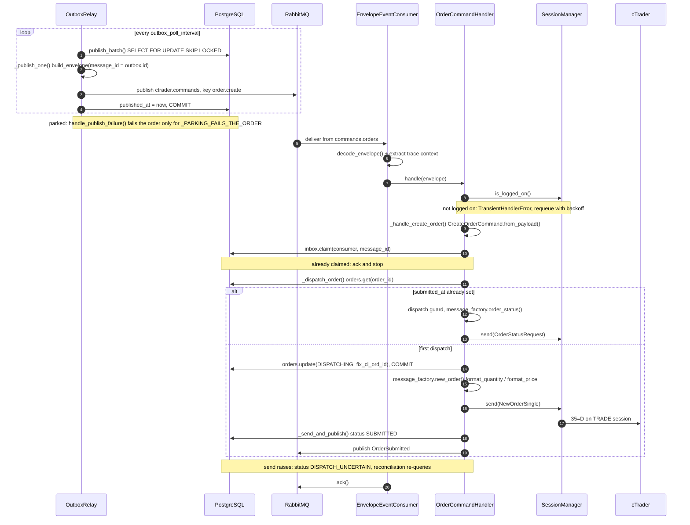
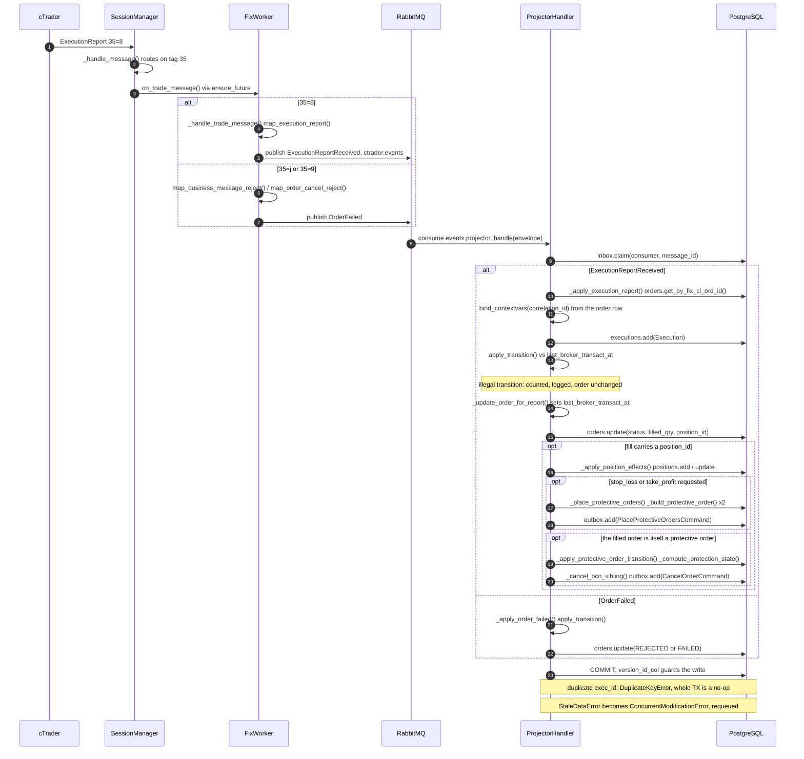
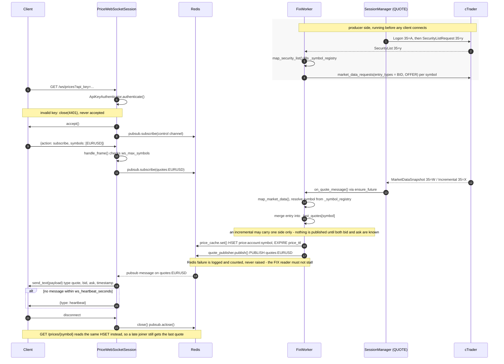

# System flow diagrams

How a request moves through the gateway, from the REST and WebSocket API to cTrader and back.

## 1. POST /orders — inside the API process

Middleware and dependencies, router, PlaceOrderHandler, unit of work and PostgreSQL, ending at PlaceOrderResponse.

## 2. POST /orders — relay to FIX worker to cTrader

The outbox row becomes a command, the dispatch guard runs, and NewOrderSingle goes out on the TRADE session.

## 3. Execution report — cTrader to projector

The fill returns as a raw event, and the projector turns it into order, position and protection state.

## 4. WS /ws/prices — cTrader to client via Redis

How a quote travels from the QUOTE FIX session through Redis pub/sub to a subscribed WebSocket client.

